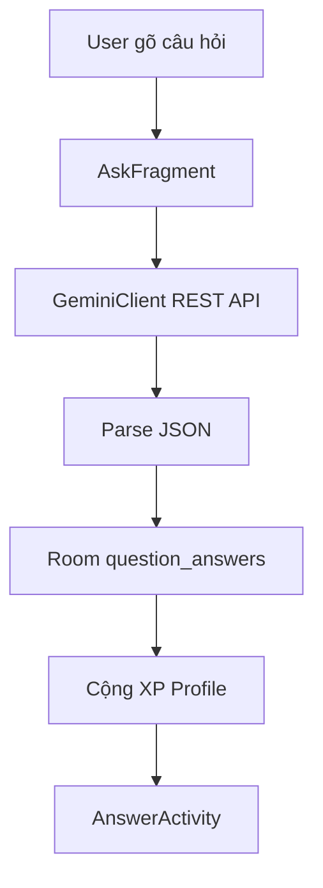

# Phase 3 & 4 — Lưu Q&A + Hỏi Gemini + Xem đáp án

> Hướng dẫn step-by-step. Code Kotlin thuần, gọi DAO trực tiếp, không Repository/ViewModel, threading bằng `Executor` + `runOnUiThread`.

**Mục tiêu:** User nhập câu hỏi → AI trả lời → lưu SQLite → xem lại → +50 XP.

**Điều kiện:** Đã xong Phase 0–2 (Login, Profile, Onboarding, BottomNav). Project đã cấu hình Kotlin + KSP cho Room (`alias(libs.plugins.ksp)`, `ksp(libs.room.compiler)`).

---

## Tổng quan luồng

```
Tab Ask (AskFragment)
  → buildPrompt (level + style từ Profile)
  → GeminiClient.ask() trên background thread
  → parse JSON từ AI
  → QuestionAnswerDao.insert()
  → Profile.xp += 50
  → AnswerActivity (đọc qaId từ Intent)
```



---

## Danh sách file

| File | Phase | Việc |
|------|-------|------|
| `database/QuestionAnswer.kt` | 3 | Entity bảng `question_answers` |
| `database/QuestionAnswerDao.kt` | 3 | CRUD + query |
| `database/AppDatabase.kt` | 3 | Version 3, thêm DAO |
| `ask/GeminiClient.kt` | 4 | Gọi Gemini REST API |
| `ask/AskFragment.kt` | 4 | UI + logic hỏi AI |
| `answer/AnswerActivity.kt` | 4 | Hiển thị đáp án |
| `res/layout/fragment_ask.xml` | 4 | Layout tab Ask |
| `res/layout/activity_answer.xml` | 4 | Layout màn Answer |
| `res/values/strings.xml` | 4 | Text UI |
| `app/build.gradle.kts` | 4 | `BuildConfig.GEMINI_API_KEY` |
| `local.properties` | 4 | API key (không commit) |
| `AndroidManifest.xml` | 4 | INTERNET + AnswerActivity |

Code đầy đủ từng file và vị trí chèn: xem `docs/PHASE_3_4_STEP_BY_STEP_CODE.md`.

---

# PHASE 3 — Room QuestionAnswer

## Bước 1: Tạo Entity `QuestionAnswer`

**File:** `app/src/main/java/com/aistudy/aistudy/database/QuestionAnswer.kt`

Mỗi dòng = 1 câu hỏi đã hỏi AI.

| Cột | Kiểu Kotlin | Ý nghĩa |
|-----|-------------|---------|
| `id` | `Long` (auto) | Khóa chính |
| `userId` | `Long` | User nào hỏi |
| `subject` | `String?` | `math`, `science`, `code`, `history`, `language`, `other` |
| `question` | `String?` | Câu hỏi gốc |
| `steps` | `String?` | Các bước giải — lưu dạng **JSON string** |
| `finalAnswer` | `String?` | Đáp án cuối |
| `starred` | `Boolean` | Đánh dấu yêu thích (dùng Phase 7) |
| `createdAt` | `Long` | `System.currentTimeMillis()` |

Tạo file với nội dung:

```kotlin
package com.aistudy.aistudy.database

import androidx.room.Entity
import androidx.room.PrimaryKey

@Entity(tableName = "question_answers")
class QuestionAnswer {

    @PrimaryKey(autoGenerate = true)
    var id: Long = 0

    var userId: Long = 0
    var subject: String? = null
    var question: String? = null
    var steps: String? = null
    var finalAnswer: String? = null
    var starred: Boolean = false
    var createdAt: Long = 0
}
```

**Vì sao mọi property là `var` có giá trị mặc định?** Room (qua KSP) tạo object bằng constructor không tham số rồi gán từng cột qua setter. `val` không có setter → KSP báo lỗi. Cột chuỗi khai báo `String?` vì SQLite cho phép `NULL`.

**Vì sao `steps` là String?** Room không lưu mảng object trực tiếp. Convert `JSONArray` → `toString()` khi insert, parse lại bằng `JSONArray(...)` khi đọc.

---

## Bước 2: Tạo `QuestionAnswerDao`

**File:** `app/src/main/java/com/aistudy/aistudy/database/QuestionAnswerDao.kt`

Interface — KSP tự sinh `QuestionAnswerDao_Impl` chứa code SQL.

| Hàm | Dùng khi |
|-----|----------|
| `insert(qa)` | Lưu câu hỏi mới, trả về `id` kiểu `Long` |
| `getAllByUserId(userId)` | History (Phase 7) |
| `getLatestByUserId(userId)` | Home recent (Phase 6) |
| `getById(id)` | AnswerActivity mở theo `qaId` |
| `toggleStar(id)` | Bật/tắt starred (Phase 7) |
| `countBySubject(userId, subject)` | Thống kê môn (Phase 6/7) |

Query trả 1 dòng khai báo `QuestionAnswer?` (không tìm thấy → `null`), query trả nhiều dòng khai báo `List<QuestionAnswer>`.

```kotlin
package com.aistudy.aistudy.database

import androidx.room.Dao
import androidx.room.Insert
import androidx.room.Query

@Dao
interface QuestionAnswerDao {

    @Insert
    fun insert(qa: QuestionAnswer): Long

    @Query("SELECT * FROM question_answers WHERE userId = :userId ORDER BY createdAt DESC")
    fun getAllByUserId(userId: Long): List<QuestionAnswer>

    @Query("SELECT * FROM question_answers WHERE userId = :userId ORDER BY createdAt DESC LIMIT 1")
    fun getLatestByUserId(userId: Long): QuestionAnswer?

    @Query("SELECT * FROM question_answers WHERE id = :id LIMIT 1")
    fun getById(id: Long): QuestionAnswer?

    @Query("UPDATE question_answers SET starred = NOT starred WHERE id = :id")
    fun toggleStar(id: Long)

    @Query("SELECT COUNT(*) FROM question_answers WHERE userId = :userId AND subject = :subject")
    fun countBySubject(userId: Long, subject: String): Int
}
```

---

## Bước 3: Nâng `AppDatabase` lên version 3

**File:** `app/src/main/java/com/aistudy/aistudy/database/AppDatabase.kt`

Thay đổi 3 chỗ:

1. Thêm `QuestionAnswer::class` vào mảng `entities = [...]` của `@Database`
2. Đổi `version = 2` → `version = 3`
3. Thêm `abstract fun questionAnswerDao(): QuestionAnswerDao`

File sau khi sửa:

```kotlin
package com.aistudy.aistudy.database

import android.content.Context
import androidx.room.Database
import androidx.room.Room
import androidx.room.RoomDatabase

@Database(
    entities = [
        User::class,
        Profile::class,
        QuestionAnswer::class
    ],
    version = 3,
    exportSchema = false
)
abstract class AppDatabase : RoomDatabase() {

    abstract fun userDao(): UserDao

    abstract fun profileDao(): ProfileDao

    abstract fun questionAnswerDao(): QuestionAnswerDao

    companion object {

        @Volatile
        private var instance: AppDatabase? = null

        fun getInstance(context: Context): AppDatabase {
            return instance ?: synchronized(this) {
                instance ?: Room.databaseBuilder(
                    context.applicationContext,
                    AppDatabase::class.java,
                    "aistudy.db"
                )
                    .allowMainThreadQueries()
                    .fallbackToDestructiveMigration(true)
                    .build()
                    .also { instance = it }
            }
        }
    }
}
```

`getInstance` nằm trong `companion object` nên gọi trực tiếp qua tên class: `AppDatabase.getInstance(context)`. `@Volatile` + `synchronized(this)` đảm bảo chỉ tạo 1 instance; `instance ?: ...` trả instance cũ nếu đã có.

**Lưu ý:** Project dùng `fallbackToDestructiveMigration(true)` — khi bump version, **toàn bộ DB bị xóa**. User phải đăng ký / login lại sau khi cài bản mới.

**Test Phase 3:** Build app → không crash. Mở Database Inspector trong Android Studio để xem bảng `question_answers` (trống cho đến khi hỏi AI ở Phase 4).

---

# PHASE 4 — Core loop: Ask + Gemini + Answer

## Bước 4: Cấu hình API key

### 4.1 Lấy key

1. Vào [Google AI Studio](https://aistudio.google.com/apikey)
2. Tạo API key
3. Copy key (dạng `AIza...`)

### 4.2 Ghi vào `local.properties`

**File:** `local.properties` (ở root project, **không commit git**)

```properties
sdk.dir=...
GEMINI_API_KEY=YOUR_REAL_GEMINI_API_KEY
```

### 4.3 Đọc key trong Gradle → `BuildConfig`

**File:** `app/build.gradle.kts`

Thêm 3 phần vào file hiện có:

1. `import java.util.Properties` ở dòng đầu
2. Khối đọc `local.properties` giữa `plugins { }` và `android { }`
3. `buildConfigField(...)` trong `defaultConfig` và `buildFeatures { buildConfig = true }` ngay sau `defaultConfig`

Giữ nguyên setup Kotlin đã có: `alias(libs.plugins.ksp)` và `ksp(libs.room.compiler)`. File sau Phase 4 (chưa có `recyclerview` của Phase 7 và `work.runtime` của Phase 14):

```kotlin
import java.util.Properties

plugins {
    alias(libs.plugins.android.application)
    alias(libs.plugins.ksp)
}

val localProperties = Properties()
val localPropertiesFile = rootProject.file("local.properties")
if (localPropertiesFile.exists()) {
    localProperties.load(localPropertiesFile.inputStream())
}
val geminiApiKey = localProperties.getProperty("GEMINI_API_KEY", "")

android {
    namespace = "com.aistudy.aistudy"
    compileSdk {
        version = release(36) {
            minorApiLevel = 1
        }
    }

    defaultConfig {
        applicationId = "com.aistudy.aistudy"
        minSdk = 33
        targetSdk = 36
        versionCode = 1
        versionName = "1.0"

        testInstrumentationRunner = "androidx.test.runner.AndroidJUnitRunner"
        buildConfigField("String", "GEMINI_API_KEY", "\"$geminiApiKey\"")
    }

    buildFeatures {
        buildConfig = true
    }

    buildTypes {
        release {
            isMinifyEnabled = false
            proguardFiles(
                getDefaultProguardFile("proguard-android-optimize.txt"),
                "proguard-rules.pro"
            )
        }
    }
    compileOptions {
        sourceCompatibility = JavaVersion.VERSION_11
        targetCompatibility = JavaVersion.VERSION_11
    }
}

dependencies {
    implementation(libs.activity.ktx)
    implementation(libs.appcompat)
    implementation(libs.constraintlayout)
    implementation(libs.material)
    implementation(libs.fragment)
    implementation(libs.room.runtime)
    ksp(libs.room.compiler)
    testImplementation(libs.junit)
    androidTestImplementation(libs.espresso.core)
    androidTestImplementation(libs.ext.junit)
}
```

Trong Kotlin dùng: `BuildConfig.GEMINI_API_KEY` (import `com.aistudy.aistudy.BuildConfig`).

**Sau khi sửa `local.properties`:** bắt buộc **Sync Gradle** (File → Sync Project with Gradle Files) rồi Run lại.

---

## Bước 5: Quyền INTERNET + đăng ký Activity

**File:** `app/src/main/AndroidManifest.xml`

Thêm quyền ngay dưới thẻ `<manifest ...>`:

```xml
<uses-permission android:name="android.permission.INTERNET" />
```

Thêm activity trong `<application>`, sau `.onboarding.OnboardingActivity`:

```xml
<activity
    android:name=".answer.AnswerActivity"
    android:exported="false" />
```

---

## Bước 6: `GeminiClient` — gọi API bằng Kotlin thuần

**File:** `app/src/main/java/com/aistudy/aistudy/ask/GeminiClient.kt`

`GeminiClient` là `object` (singleton): gọi `GeminiClient.ask(apiKey, prompt)` trực tiếp, không cần tạo instance. Hằng số `TAG`, `MODEL` khai báo `private const val`.

**Vì sao không dùng SDK `generativeai`?** SDK đó xây trên Kotlin coroutines (`suspend fun`), trong khi toàn bộ project dùng `Executor` + `runOnUiThread`. REST API + `HttpURLConnection` giữ `ask()` là hàm blocking bình thường, gọi được ngay trong `executor?.execute { }`, không thêm dependency và không phải quản lý `CoroutineScope`.

**Model hiện tại:** `gemini-3.5-flash` (model cũ `gemini-2.0-flash` đã bị Google tắt).

**Endpoint:**
```
POST https://generativelanguage.googleapis.com/v1beta/models/gemini-3.5-flash:generateContent?key=API_KEY
```

**Body JSON gửi đi:**
```json
{
  "contents": [{
    "parts": [{ "text": "nội dung prompt" }]
  }]
}
```

**Response — lấy text:**
```
candidates[0].content.parts[0].text
```

Các điểm Kotlin trong `ask()`:

| Chỗ | Ý nghĩa |
|-----|---------|
| `url.openConnection() as HttpURLConnection` | Ép kiểu bằng `as` |
| `conn.requestMethod = "POST"`, `conn.doOutput = true`, `conn.readTimeout = 60000` | Gán dạng property |
| `conn.outputStream.use { os -> os.write(bytes) }` | `use` tự đóng stream |
| `if (code in 200..299)` | Kiểm tra khoảng HTTP thành công |
| `throw Exception("HTTP $code: $responseBody")` | Lỗi HTTP ném ra cho `AskFragment` bắt |

**Log tag:** `GeminiClient` — xem httpCode, preview response trong Logcat.

Nếu model lỗi 404, đổi hằng số `MODEL` trong file này (ví dụ `gemini-2.5-flash`).

---

## Bước 7: Layout tab Ask

**File:** `app/src/main/res/layout/fragment_ask.xml`

Thành phần chính:

| ID | Widget | Việc |
|----|--------|------|
| `edit_question` | EditText | Nhập câu hỏi |
| `btn_send` | MaterialButton | Gửi |
| `progress_loading` | ProgressBar | Hiện khi đang gọi AI |
| `btn_suggestion_1` … `4` | MaterialButton | Gợi ý câu hỏi mẫu |

**File strings:** `res/values/strings.xml` — `ask_title`, `ask_hint`, `ask_send`, `ask_sending`, v.v.

---

## Bước 8: `AskFragment` — logic chính

**File:** `app/src/main/java/com/aistudy/aistudy/ask/AskFragment.kt`

View khai báo `private lateinit var` (gán trong `onViewCreated` bằng `findViewById`), `executor` khai báo `private var executor: ExecutorService? = null`. Hằng số `TAG`, `SUBJECTS`, `XP_PER_QUESTION` và helper `maskKey`, `truncate` nằm trong `companion object`.

### 8.1 Khi user bấm Send

```
1. Kiểm tra câu hỏi không rỗng
2. Kiểm tra BuildConfig.GEMINI_API_KEY có giá trị
3. setLoading(true) — disable nút, hiện ProgressBar
4. Lấy userId từ SharedPreferences (LoginActivity.PREFS_AUTH, LoginActivity.KEY_USER_ID)
5. Đọc Profile → level, style (profile có thể null → mặc định "high", "stepwise")
6. buildPrompt(question, level, style)
7. executor?.execute { ... }  ← KHÔNG gọi network trên main thread
```

### 8.2 Trong background thread

```
1. GeminiClient.ask(apiKey, prompt) → raw text
2. extractJson(raw) → cắt JSON nếu AI bọc markdown ```
3. JSONObject(jsonText) → subject, steps, finalAnswer
4. Tạo QuestionAnswer() → qaDao.insert(qa) → qaId
5. profile.xp += XP_PER_QUESTION → profileDao.update(profile)
6. requireActivity().runOnUiThread { startActivity(AnswerActivity + EXTRA_QA_ID) }
```

Text rỗng từ AI → `return@execute` (thoát khỏi lambda). Mọi exception (network, JSON) bắt trong `catch (e: Exception)` → `showError(...)`.

### 8.3 Prompt gửi cho AI

Prompt yêu cầu AI trả **JSON thuần** (giống web `deliver_solution`):

```json
{
  "subject": "math",
  "steps": [
    { "title": "Step 1", "body": "...", "expr": "x = 2" }
  ],
  "finalAnswer": "x = 2 or x = 3"
}
```

`level` map (bằng `when`): `junior` / `high` / `uni`  
`style` map (bằng `when`): `short` / `detailed` / `stepwise`

### 8.4 Threading

| Việc | Thread |
|------|--------|
| UI (EditText, Button) | Main |
| Đọc Profile trước khi gửi | Main (vì `allowMainThreadQueries()`) |
| Gọi Gemini | `ExecutorService` background |
| Room insert QA + update Profile | `ExecutorService` background |
| Toast, startActivity | `runOnUiThread` |

---

## Bước 9: Layout + `AnswerActivity`

**Layout:** `app/src/main/res/layout/activity_answer.xml`

| ID | Hiển thị |
|----|----------|
| `btn_back` | Nút quay lại |
| `tv_subject` | Tên môn (Math, Science…) |
| `tv_question` | Câu hỏi gốc |
| `layout_steps` | Container — thêm step bằng code |
| `tv_final_answer` | Đáp án cuối |

**File:** `app/src/main/java/com/aistudy/aistudy/answer/AnswerActivity.kt`

```
1. Nhận qaId từ Intent: intent.getLongExtra(EXTRA_QA_ID, -1); nếu qaId == -1L → Toast + finish()
2. dao.getById(qaId) → QuestionAnswer?; nếu null → Toast + finish()
3. Hiển thị question, finalAnswer (tvQuestion.text = item.question)
4. Parse item.steps bằng JSONArray(item.steps) → addStepView() cho từng bước
5. btnBack.setOnClickListener { finish() }
```

`EXTRA_QA_ID` khai báo `const val` trong `companion object` → nơi khác dùng `AnswerActivity.EXTRA_QA_ID`. Activity gọi `enableEdgeToEdge()` trước `setContentView`.

Mỗi step có: số thứ tự, `title` (optional), `body`, `expr` (công thức, optional).

---

## Bước 10: Test end-to-end

1. Sync Gradle (sau khi set API key)
2. Run app trên emulator/thiết bị có internet
3. Register hoặc Login
4. Hoàn thành Onboarding (3 bước)
5. Tab **Ask** → chọn gợi ý hoặc gõ câu hỏi → **Send**
6. Đợi vài giây → tự mở **AnswerActivity**
7. Kiểm tra:
   - Câu hỏi + các bước + đáp án hiển thị
   - Bấm Back về tab Ask

**Kiểm tra XP:** Mở Database Inspector → bảng `profiles` → cột `xp` tăng 50 mỗi câu hỏi.

**Kiểm tra DB:** Bảng `question_answers` có 1 row mới.

---

## Debug bằng Logcat

Filter:
```
tag:AskFragment | tag:GeminiClient
```

| Log | Ý nghĩa |
|-----|---------|
| `AskFragment: submit start` | Bắt đầu gửi |
| `AskFragment: submit blocked: api key missing or placeholder` | Chưa set key / chưa Sync Gradle |
| `GeminiClient: response httpCode=200` | API OK |
| `GeminiClient: request failed httpCode=404` | Model name sai — đổi `MODEL` |
| `GeminiClient: request failed httpCode=403` | Key sai hoặc API chưa bật |
| `AskFragment: parsed subject=... steps=N` | Parse JSON OK |
| `AskFragment: saved qaId=...` | Lưu DB OK |
| `AskFragment: submit failed` + stacktrace | Lỗi parse JSON hoặc network |

API key **không** log đầy đủ — chỉ dạng `AIza...abcd` (hàm `maskKey`).

---

## Lỗi thường gặp

| Triệu chứng | Nguyên nhân | Cách sửa |
|-------------|-------------|----------|
| Toast "GEMINI_API_KEY not set" | Key trống hoặc `YOUR_KEY_HERE` | Sửa `local.properties` → Sync Gradle → Run lại |
| HTTP 404 model not available | Model cũ | Đổi `MODEL` trong `GeminiClient.kt` |
| HTTP 403 | Key invalid | Tạo key mới trên AI Studio |
| Toast "Could not get AI response" | AI trả markdown thay JSON | Thử lại; xem log `raw response preview` |
| App crash khi mở Ask sau update | DB version cũ | Gỡ app / Clear data → cài lại |
| Không có internet | Emulator offline | Bật Wi‑Fi emulator |
| Build lỗi `Unresolved reference: BuildConfig` | Thiếu `buildFeatures { buildConfig = true }` | Thêm vào `android { }` → Sync Gradle |
| Build lỗi `Unresolved reference: questionAnswerDao` | Chưa khai báo `abstract fun questionAnswerDao()` | Thêm vào `AppDatabase.kt` → Build lại để KSP sinh lại `AppDatabase_Impl` |
| Build lỗi `[ksp] ... Cannot find setter for field` | Entity dùng `val` | Đổi property của `QuestionAnswer` sang `var` |
| Crash `UninitializedPropertyAccessException: lateinit property ... has not been initialized` | Dùng view `lateinit` trước `findViewById` | Gán view ở đầu `onViewCreated` |
| Crash `NetworkOnMainThreadException` | Gọi `GeminiClient.ask` trên main thread | Đặt lời gọi trong `executor?.execute { }` |

---

## JSON `steps` — ví dụ lưu trong DB

```json
[
  {
    "title": "Identify coefficients",
    "body": "In ax² + bx + c = 0, we have a=1, b=-5, c=6.",
    "expr": "x² - 5x + 6 = 0"
  },
  {
    "title": "Factor",
    "body": "The expression factors to (x-2)(x-3) = 0.",
    "expr": "(x-2)(x-3) = 0"
  }
]
```

Lưu: `qa.steps = stepsArray.toString()`  
Đọc: `JSONArray(item.steps)`

---

## So sánh với Web

| Web | Android |
|-----|---------|
| `ask.tsx` | `AskFragment` + `fragment_ask.xml` |
| `ai.functions.ts` → `askAI` | `GeminiClient.ask` + `buildPrompt` |
| `answer.$id.tsx` | `AnswerActivity` |
| Supabase lưu QA | Room `question_answers` |
| `google/gemini-3-flash-preview` (Lovable gateway) | `gemini-3.5-flash` (REST trực tiếp) |

---

## Tiếp theo (Phase 5+)

| Phase | Việc |
|-------|------|
| 5 | Home v1 — hiển thị fullName, XP, streak, CTA Ask |
| 6 | Home v2 — recent question + stats theo môn |
| 7 | History + Progress dùng `QuestionAnswerDao` |
| 8 | Logout, polish UX |

---

## Checklist hoàn thành Phase 3–4

- [ ] `QuestionAnswer.kt` tạo xong
- [ ] `QuestionAnswerDao.kt` tạo xong
- [ ] `AppDatabase` version 3 + `questionAnswerDao()`
- [ ] `GEMINI_API_KEY` trong `local.properties`
- [ ] `build.gradle.kts` có `buildConfigField` + `buildFeatures.buildConfig`, vẫn giữ `alias(libs.plugins.ksp)` + `ksp(libs.room.compiler)`
- [ ] `AndroidManifest` có INTERNET + AnswerActivity
- [ ] `GeminiClient.kt` gọi API thành công (httpCode 200)
- [ ] `AskFragment` gửi câu hỏi → lưu DB → +XP
- [ ] `AnswerActivity` hiển thị steps + final answer
- [ ] Logcat không có lỗi `submit failed`
